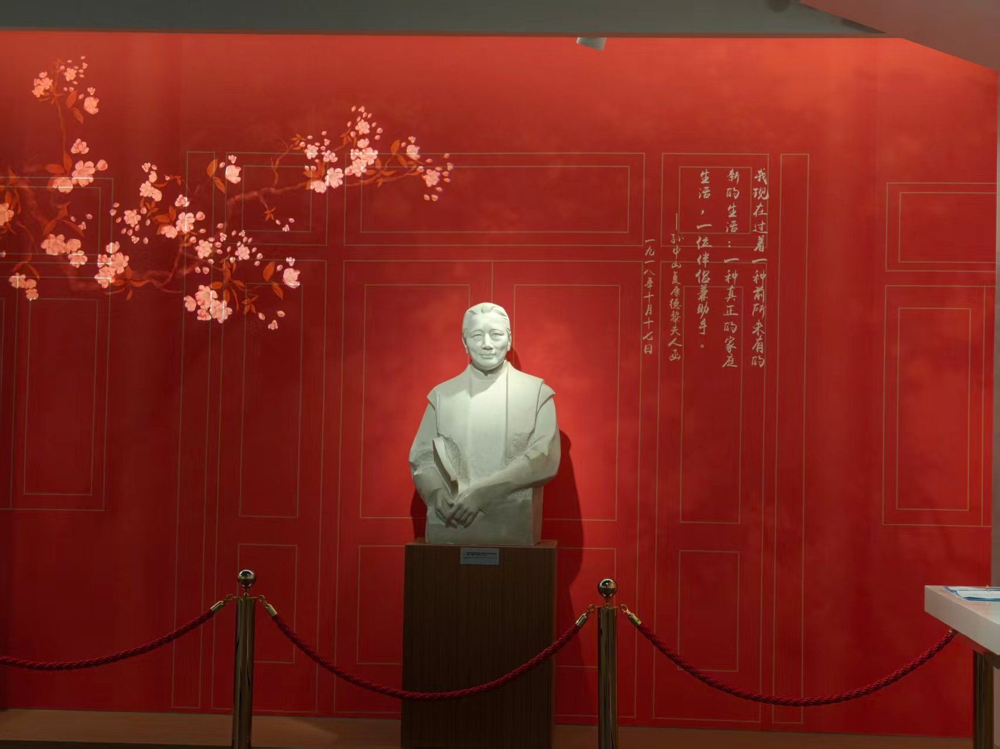
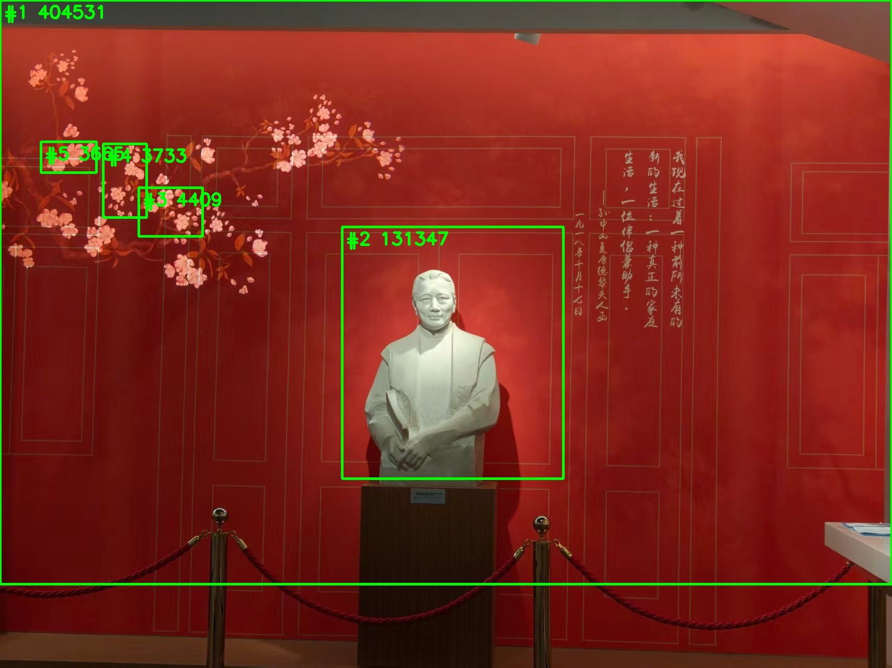
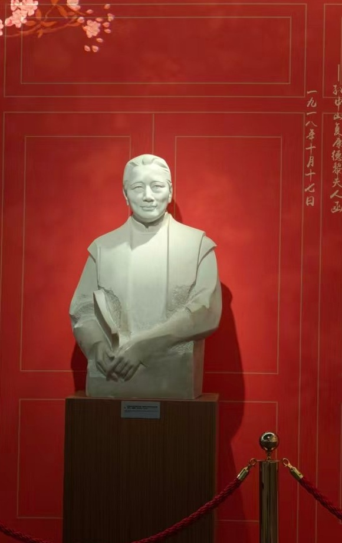
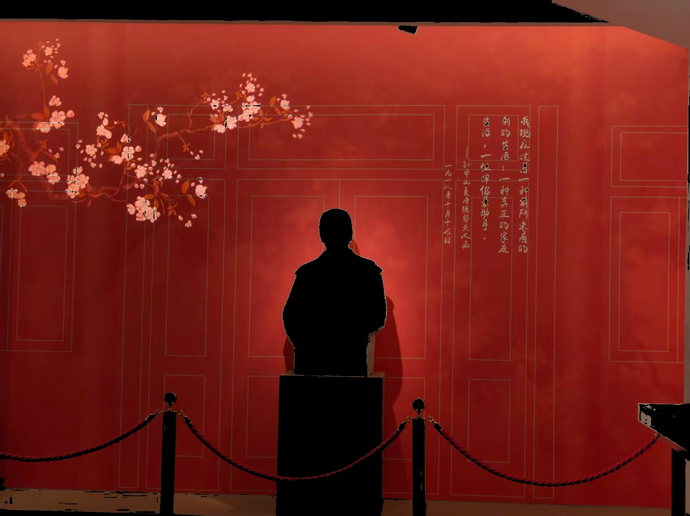
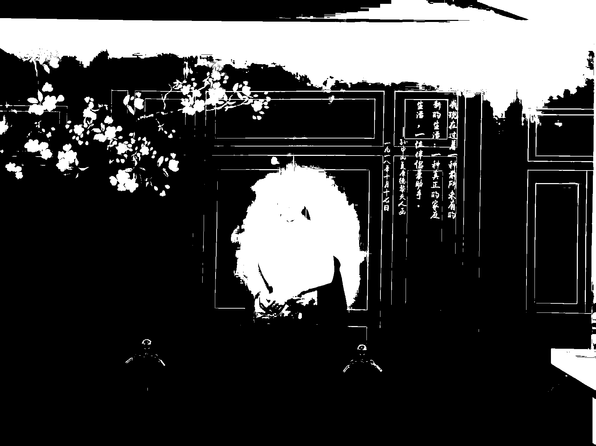
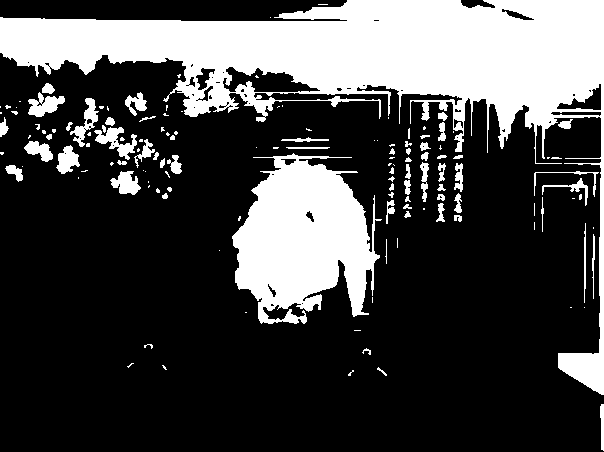
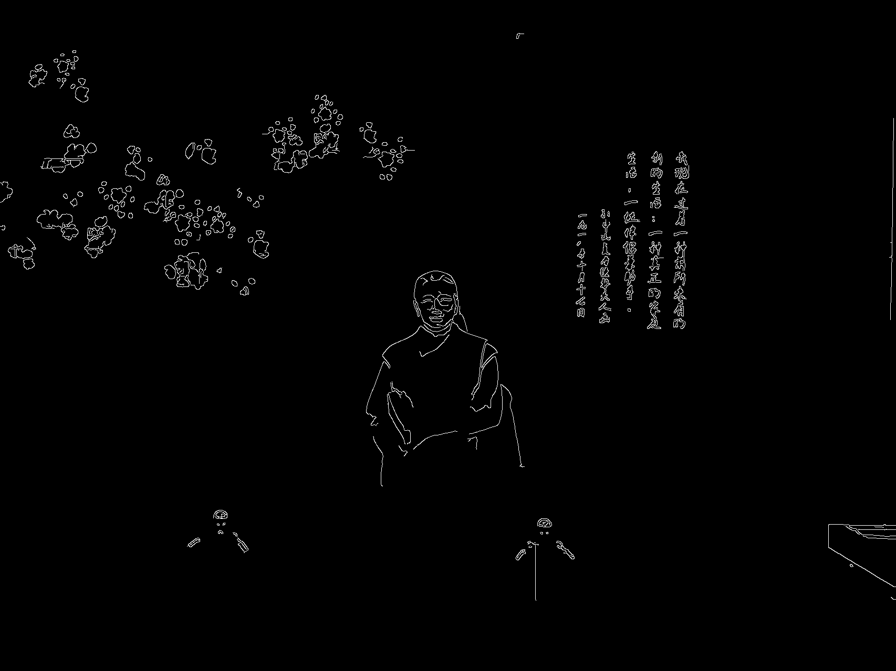

# 最小视觉小任务 · 导航方向

OpenCV + CMake 实现：主任务（二值化 + 连通域统计）+ 5 项进阶要求（ROI / 缩放 / HSV / 模糊二值化 / Canny）。

## 环境

- Ubuntu 24.04，g++ 13.3.0，CMake 3.28.3，OpenCV 4.11.0
- 依赖安装：

```bash
sudo apt install -y build-essential cmake libopencv-dev
```

## 目录

| 目录 | 内容 | 输出 |
|---|---|---|
| `task0_nav/` | **主任务**：二值化分离障碍/可通行，连通域统计 | `result_binary.png`、`result_regions.jpg` |
| `task1_roi/` | ① ROI 裁剪 | `result_roi.jpg` |
| `task2_resize/` | ② 缩放 0.5× | `result_resize.jpg` |
| `task3_hsv/` | ③ HSV 转换 + 红色区域筛选 | `result_hsv.jpg`、`result_red_mask.png`、`result_red_only.jpg` |
| `task4_blur_binary/` | ④ 高斯模糊前后二值化对比 | `result_binary_raw.png`、`result_binary_blur.png`、`result_blur.jpg` |
| `task5_canny/` | ⑤ Canny 边缘提取 | `result_canny.png` |

每个目录都是独立的 CMake 工程，自带 `train.jpg`，运行后结果直接生成在同目录。

## 编译运行

```bash
cd task0_nav
cmake -S . -B build
cmake --build build
./build/task0_nav
```

其余任务同理，把 `task0_nav` 换成对应目录名（可执行文件名和目录名一致）。

## 运行结果

**主任务（task0_nav）**

```
=== 导航方向 · 二值化 + 连通域统计 ===
原图: 1706 x 1279
Otsu 阈值: 75
连通域总数: 153
障碍像素: 595636 (27.3%)
可通行像素: 1586338 (72.7%)

前 5 大障碍区域:
  #1 面积=404531 外接框=(0,0,1706,1119) 质心=(1044,187)
  #2 面积=131347 外接框=(654,434,424,483) 质心=(857,677)
  #3 面积=4409  外接框=(265,359,123,94) 质心=(327,399)
  #4 面积=3733  外接框=(197,275,84,142) 质心=(243,343)
  #5 面积=3665  外接框=(78,271,107,60) 质心=(127,299)
```

**进阶任务**

| 任务 | 关键输出 |
|---|---|
| ROI | 580 × 921 |
| 缩放 | 853 × 640 |
| HSV | 红色占比 86.8% |
| 模糊二值化 | Otsu 78 → 75，差异 100703 像素 |
| Canny | 边缘 8215 像素 |

## 结果预览

| 原图 | 主任务 |
|---|---|
|  |  |

| ROI | 缩放 | HSV |
|---|---|---|
|  |  |  |

| 二值化（模糊前） | 二值化（模糊后） | Canny |
|---|---|---|
|  |  |  |

## 200 字说明

> 我选导航方向：训练图是展厅照片，无灯条和圆形目标，自瞄、大符不适用，故选导航。做法：灰度化 → 11×11 高斯模糊 → Otsu 二值化 → 连通域统计，按面积排序输出前 5 名的面积、外接框和质心并画框；另完成 ROI、缩放、HSV 筛色、二值化对比、Canny 五项进阶。
> 难点：直接二值化时墙面花纹碎成噪点，主体被淹没。解决：先高斯模糊再二值化，阈值 78→75，连通域降到 153 个，第二大（13 万像素）正好是雕像本体。

## 关键代码

```cpp
// 二值化
cv::cvtColor(img, gray, cv::COLOR_BGR2GRAY);
cv::GaussianBlur(gray, blur, cv::Size(11, 11), 0);
double th = cv::threshold(blur, bin, 0, 255, cv::THRESH_BINARY | cv::THRESH_OTSU);

// 连通域
cv::Mat labels, stats, centroids;
int n = cv::connectedComponentsWithStats(bin, labels, stats, centroids, 8, CV_32S);

// 按面积排序，取前 5 大
std::sort(idx.begin(), idx.end(), [&](int a, int b) {
    return stats.at<int>(a, cv::CC_STAT_AREA) > stats.at<int>(b, cv::CC_STAT_AREA);
});
```
